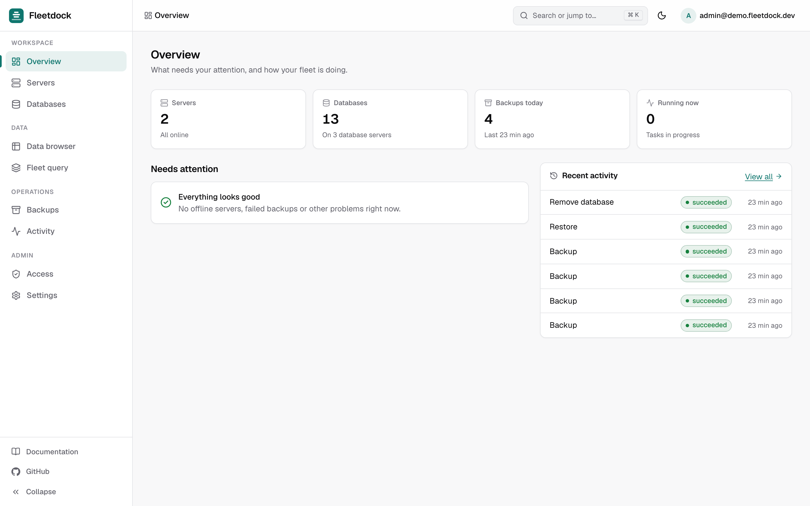
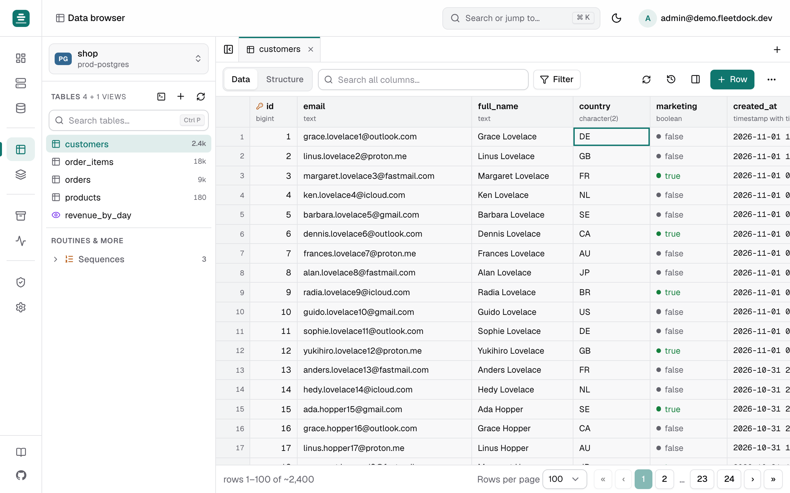
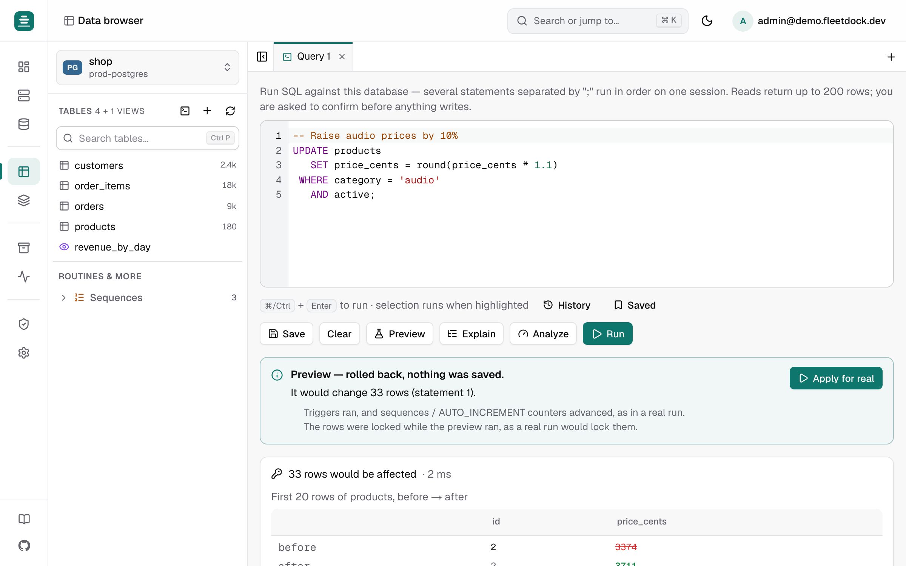
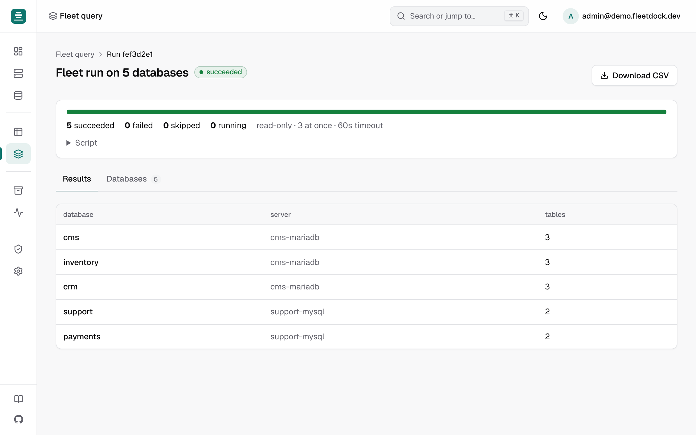
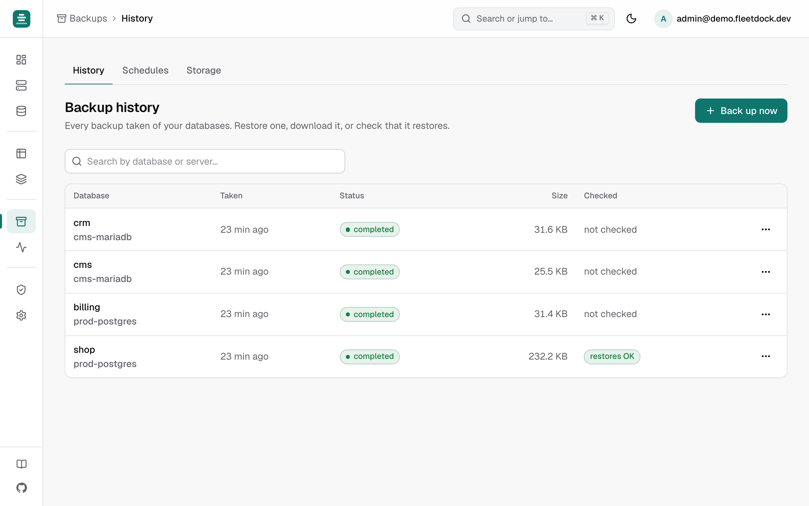

<h1>
  <picture>
    <source media="(prefers-color-scheme: dark)" srcset="brand/svg/fleetdock-logo-dark.svg">
    
  </picture>
</h1>

[](https://github.com/Fleetdock/fleetdock/actions/workflows/ci.yml)
[](LICENSE)
[](backend/go.mod)
[](https://fleetdock.dev)

An open-source, self-hosted **dashboard for your databases** — MariaDB, MySQL
and PostgreSQL. Manage database servers, databases, users and backups from one
place instead of SSH, without handing your credentials to a SaaS vendor.

Think of it as one web GUI for every database server you run: a data browser
and SQL console like phpMyAdmin or pgAdmin, plus what those don't do — SQL
across up to 500 databases at once, scheduled backups to your own S3 bucket,
restores, and moving databases between servers.
[How it compares](https://fleetdock.dev/alternatives) ·
[Guides](https://fleetdock.dev/guides) ·
[Documentation](https://fleetdock.dev/docs)

<picture>
  <source media="(prefers-color-scheme: dark)" srcset="docs/screenshots/dark/overview.png">
  
</picture>

<table>
  <tr>
    <td width="50%"><br><sub><b>Data browser</b>: edit rows in place, follow foreign keys, undo any save.</sub></td>
    <td width="50%"><br><sub><b>SQL console</b>: preview what an UPDATE will change before it runs.</sub></td>
  </tr>
  <tr>
    <td width="50%"><br><sub><b>Fleet query</b>: one SQL script on up to 500 databases.</sub></td>
    <td width="50%"><br><sub><b>Backups</b>: scheduled, to your own S3 bucket, test-restored.</sub></td>
  </tr>
</table>

More in [docs/screenshots/](docs/screenshots/).

## Quick start

**1. Get a Linux server** — 2 vCPU and 4 GB RAM is enough to start, with ports
80 and 443 open. A domain pointed at it is optional.

**2. Run one command on it:**

```bash
curl -sSL https://fleetdock.dev/install.sh | sudo sh
```

> On a **Mac** or **Windows** PC (WSL2), leave out `sudo` and see
> [LOCAL.md](docs/LOCAL.md) — Fleetdock then runs privately on that computer.

It asks for a domain (or picks a free `<ip>.sslip.io` name with HTTPS) and an
admin email, shows what it will do, and waits for you to confirm. Then it
installs Docker if needed and starts Fleetdock behind automatic HTTPS. At the
end it prints your login:

```text
  Fleetdock is running.

    Dashboard   https://db.example.com
    Email       admin@example.com
    Password    8fK2mQ...
```

For scripts and cloud-init, pass everything up front and skip the questions:
`curl -sSL https://fleetdock.dev/install.sh | sudo sh -s -- --domain db.example.com --admin-email you@example.com --yes`.

**3. Sign in and connect your databases.**

- **Servers → Connect server** shows a command to run on each database server.
  It installs the Fleetdock agent, which lets Fleetdock create database
  containers, run backups and report health on that server.
- **Databases → Connect database server** adds a database Fleetdock can reach
  directly — hosted (RDS, Neon, …) or on your network — no agent needed.

That's it. Day to day, use the `fleetdock` command the installer added:

```bash
fleetdock status                # is everything running?
fleetdock credentials           # dashboard URL and admin login
fleetdock update                # back up, then move to the latest release
fleetdock doctor                # diagnose DNS, certificates, reachability
fleetdock reset-admin-password  # locked out
fleetdock help                  # everything else
```

> **Two installers, two jobs.** `fleetdock.dev/install.sh` (the **Fleetdock
> installer**) runs once, on the machine that hosts the dashboard. The command
> from **Servers → Connect server** (the **agent installer**, served by your own
> Fleetdock) runs on each database server you want Fleetdock to manage.

## Which guide do I need?

| I want to… | Guide |
| --- | --- |
| Run Fleetdock on a server for my team | The [Quick start](#quick-start) above; options and details in [DEPLOYMENT.md](docs/DEPLOYMENT.md) |
| Run it only on my own computer (macOS, Linux, Windows) | [LOCAL.md](docs/LOCAL.md) — `curl -sSL https://fleetdock.dev/install.sh \| sh -s -- --local` |
| Install from a fork, a private copy, or without internet access | [DEPLOYMENT.md → Installing from a checkout](docs/DEPLOYMENT.md#installing-from-a-checkout-forks-air-gapped-testing) |
| Use my own reverse proxy or a hosted PostgreSQL | [DEPLOYMENT.md](docs/DEPLOYMENT.md#bring-your-own-reverse-proxy) |
| Back up, upgrade, rotate keys | [OPERATIONS.md](docs/OPERATIONS.md) |
| Harden it before exposing it to the internet | [SECURITY-CHECKLIST.md](docs/SECURITY-CHECKLIST.md) |
| Change a setting | [CONFIGURATION.md](docs/CONFIGURATION.md) |
| Work on Fleetdock's code | [CONTRIBUTING.md](CONTRIBUTING.md) |

## How it fits together

```text
Your browser ──HTTPS──► Fleetdock (dashboard + API, one container)
                            │
                            ├── PostgreSQL   its own metadata: users, servers, list of backups
                            ├── agents ◄──── your database servers (installed from the dashboard)
                            └── direct ────► databases it can reach over the network
```

- **Server** — a machine running the Fleetdock agent.
- **Database server** (an _instance_ in the API) — one MariaDB, MySQL or
  PostgreSQL process: created by Fleetdock on one of your servers, already
  running there, or reachable anywhere over the network.
- **Database** — found automatically on each database server Fleetdock has a
  login for.
- **Backup storage** — an S3, Cloudflare R2 or S3-compatible bucket. Stored
  passwords and keys are encrypted with `FLEETDOCK_ENCRYPTION_KEY`.

What it can do, in detail: [docs/FEATURES.md](docs/FEATURES.md). The words the
dashboard uses: [docs/glossary.md](docs/glossary.md). The HTTP API is documented
at `https://<your-fleetdock>/docs`.

## Repository layout

```text
backend/            Go API, background worker and agent
  cmd/api           the control plane; also serves the dashboard
  cmd/agent         the agent that runs on each database server
frontend/           Next.js dashboard
scripts/            install.sh (Fleetdock installer) and the fleetdock command
docs/               guides
Dockerfile          one image: API + dashboard (ghcr.io/fleetdock/fleetdock)
docker-compose.yml  Caddy + Fleetdock + PostgreSQL (+ optional gateway)
```

## Contributing

Contributions are welcome — [CONTRIBUTING.md](CONTRIBUTING.md) covers running
Fleetdock from source, tests and pull requests.

[Code of Conduct](CODE_OF_CONDUCT.md) · [Security policy](SECURITY.md) ·
[Changelog](CHANGELOG.md) · [Roadmap](ROADMAP.md) · [Releasing](RELEASING.md)

Licensed under [Apache-2.0](LICENSE).
